# Netrunner HUD

> Un mod HUD cyberpunk pour [Claude Code](https://claude.com/claude-code) : la fenêtre de contexte devient ta **RAM**,
> la limite de tokens sur 5 heures devient tes **HP**, et chaque appel d'outil devient un quickhack.

🇬🇧 [English version](README.md)

<p align="center">
  
  <br>
  
</p>

## Fonctionnalités

**Barre HP / RAM au-dessus du prompt**

- **HP** : ce qui reste de la limite de tokens sur 5 h, avec le compte à rebours avant la régénération
  (`REGEN DANS 2H14`). Passe au jaune sous 50, au rouge et clignote sous 20.
- **RAM** : 10 cellules pour le contexte libre (`CONTEXTE · 64k / 200k`). La cellule qui vient de sauter s'affiche en rouge.
- **Texte d'ambiance** selon l'état : `NEURAL LINK STABLE`, `SURCHAUFFE CYBERDECK`, `☠ FLATLINE`…
- Rendu SVG dans l'app de bureau (segments inclinés, lueur, glitch chromatique), version texte dans le terminal.

**Fond Night City** *(pas encore pris en charge par Claude Code)* : skyline néon, soleil couchant, grille en
perspective et ligne de balayage animée, derrière un panneau de verre teinté. Le mod l'inclut déjà, mais aucune
version actuelle de Claude Code n'affiche de fond personnalisé : tu ne le verras donc pas pour l'instant.

<p align="center">
  
</p>

**Outils en quickhacks** : chaque appel d'outil reçoit une étiquette (`Bash` → SHORT CIRCUIT, `Grep` → BREACH PROTOCOL,
`Edit` → REBOOT OPTICS…, liste complète dans le [README anglais](README.md#features)). Une erreur s'affiche en
`✖ ICE DÉTECTÉ — CONTRE-HACK`.

**Indicateur d'activité** : « Breach Protocol », « Décryptage ICE », « Uplink Netwatch »…

**Notifications** quand la RAM devient faible (avec un rappel de `/compact`), quand les HP sont critiques et quand
la limite se réinitialise.

## Installation

Cloner le dépôt dans le dossier des mods de Claude Code, puis ouvrir une nouvelle session :

```bash
git clone https://github.com/Mohamed-Hacene/netrunner-hud.git ~/.claude/mods/netrunner-hud
```

Mise à jour :

```bash
git -C ~/.claude/mods/netrunner-hud pull
```

Pour désinstaller, supprimer le dossier `~/.claude/mods/netrunner-hud`.

> [!NOTE]
> Claude Code n'affiche pas encore de fond personnalisé. Le fond Night City est inclus et prêt : `/nightcity`
> indique qu'il est en attente, et il apparaîtra tout seul quand Claude Code le prendra en charge.

## Commandes

| Commande | Effet |
|---|---|
| `/hud` | Affiche ou masque la barre HP / RAM |
| `/nightcity` | Active ou coupe le fond Night City (sans effet visible tant que Claude Code ne gère pas les fonds) |

Les deux réglages sont conservés d'une session à l'autre.

## Personnalisation

| Quoi | Où |
|---|---|
| Couleurs | en tête de `hooks/register.tsx` et `hooks/hud-svg.ts` |
| Nombre de cellules de RAM | `MAX` dans `hooks/register.tsx` |
| Noms des quickhacks | `QUICKHACK` dans `hooks/register.tsx` |
| Textes de l'indicateur | `SPIN_WORDS` dans `hooks/register.tsx` |
| Textes d'ambiance et paliers | `flavor()` dans `hooks/register.tsx` |
| Notifications | gestionnaire `session.measure` dans `hooks/register.tsx` |
| Skyline, soleil, grille | `hooks/backdrop.ts` |

## Contribuer

Les issues et pull requests sont les bienvenues, voir [CONTRIBUTING.md](CONTRIBUTING.md).

## Licence

[MIT](LICENSE)

---

Projet de fan non officiel, sans lien avec CD PROJEKT RED ni Anthropic.
*Cyberpunk* et *Night City* sont des marques de leurs propriétaires respectifs.
