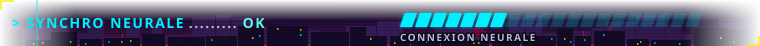
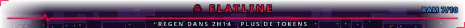
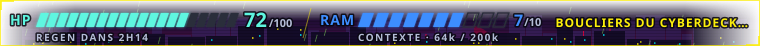

# Netrunner HUD

> A cyberpunk HUD mod for [Claude Code](https://claude.com/claude-code): your context window becomes **RAM**,
> your 5-hour token limit becomes **HP**, and every tool call turns into a quickhack.


🇫🇷 [Version française](README.fr.md)

<p align="center">
  
  <br>
  
</p>

## Features

**HP / RAM band above the prompt**

- **HP**: what is left of your 5-hour token limit, with a countdown until it regenerates (`REGEN DANS 2H14`).
  Turns yellow below 50 and red, pulsing, below 20.
- **RAM**: 10 cells showing your free context window (`CONTEXTE · 64k / 200k`). The cell you just lost flashes red.
- **Status line** that follows your state: `NEURAL LINK STABLE`, `SURCHAUFFE CYBERDECK`, `☠ FLATLINE`…
- Drawn as SVG on desktop (slanted segments, glow, chromatic glitch), plain text in the terminal.
- **Night City scenery** behind the band (desktop): skyline, lit windows, horizon glow, faded into the app. The sky
  follows the time of day: night (19h–7h), dawn (7h–10h), smog by day (10h–16h), dusk (16h–19h).
- **Boot sequence** when a session starts, then a **welcome message** picked at random.
- **Glitch** when you take damage (a RAM cell lost, HP dropping a tens).
- **RIPPERDOC**: after `/compact`, RAM cells refill one by one in green; when your limit resets, so does HP.
- **FLATLINE**: at 0 HP the band becomes a flat heart monitor until it regenerates.
- **End of a reply**: a cyan sweep crosses the band (`◆ BREACH COMPLETE`).

**Night City backdrop** *(not supported by Claude Code yet)*: neon skyline, setting sun, perspective grid and an
animated scanline behind a tinted glass panel. The mod already ships it, but no current version of Claude Code
draws custom backdrops, so you will not see it for now. See [Compatibility](#compatibility).

<p align="center">
  
</p>

**Quickhack tool rows**: each tool call gets a tag under its row.

| Tool | Quickhack |
|---|---|
| `Bash`, `PowerShell` | SHORT CIRCUIT |
| `Read` | PING |
| `Grep` | BREACH PROTOCOL |
| `Glob` | SCAN |
| `Edit` | REBOOT OPTICS |
| `Write` | SYSTEM RESET |
| `WebFetch` | REMOTE UPLINK |
| `WebSearch` | NET DIVE |
| `Agent` | SUMMON DAEMON |

Errors show up as `✖ ICE DÉTECTÉ — CONTRE-HACK`, interruptions as `◼ QUICKHACK ANNULÉ`.

**Netrunning spinner**: "Breach Protocol", "Décryptage ICE", "Uplink Netwatch"…

**Toasts** when RAM runs low (with a `/compact` reminder), when HP hits critical, and when your limit resets.

**Random events**: about one every ten minutes at most, a three-step story plays in the band and the city reacts
(intrusion with red windows, Netwatch searchlight, power surge, acid rain…). A few **legendary** events are very rare,
and some words in your prompts trigger one (find them yourself). Purely visual: nothing is changed.

**Ambiance everywhere**: a channel header above Claude's replies, `◤ UPLINK ÉMIS` on your prompts (terminal),
`SÉQUENCE DE QUICKHACKS` on tool groups, `REQUÊTE NETWATCH` on questions, a status line, netrunner words on the turn
duration and the modes.

**Light on resources**: only the band redraws when it animates, never the transcript; desktop animations run inside
the SVG.

> The in-app texts are in French. See [Customization](#customization) to translate them.

## Gallery

Still frames of the desktop band, generated from the mod's own code with `npx tsx scripts/previews.mts`. In the app they are animated.

<p align="center">
  
  <br><sub>Boot sequence when a session starts</sub>
</p>

<p align="center">
  
  <br><sub>Welcome message</sub>
</p>

<p align="center">
  
  <br><sub>Damage glitch</sub>
</p>

<p align="center">
  
  <br><sub>RIPPERDOC: RAM refilling after /compact</sub>
</p>

<p align="center">
  
  <br><sub>FLATLINE at 0 HP</sub>
</p>

<p align="center">
  
  <br><sub>Event: intrusion, the city's windows turn red</sub>
</p>

<p align="center">
  
  <br><sub>Event: Netwatch searchlight</sub>
</p>

<p align="center">
  
  <br><sub>Event: acid rain</sub>
</p>

<p align="center">
  
  <br><sub>Legendary event</sub>
</p>

<p align="center">
  
  <br><sub>Dawn and dusk sky (7h–10h, 16h–19h)</sub>
</p>

<p align="center">
  
  <br><sub>Day sky, smog (10h–16h)</sub>
</p>

## Installation

Clone the repository into your Claude Code mods folder, then start a new session:

```bash
git clone https://github.com/Mohamed-Hacene/netrunner-hud.git ~/.claude/mods/netrunner-hud
```

To update:

```bash
git -C ~/.claude/mods/netrunner-hud pull
```

To uninstall, delete the `~/.claude/mods/netrunner-hud` folder.

### Compatibility

| Surface | HP / RAM band | Backdrop | Quickhacks and spinner |
|---|---|---|---|
| Desktop app | SVG | ❌ not supported yet | ✅ |
| Terminal | Text | ❌ | ✅ |

> [!NOTE]
> Claude Code does not draw custom backdrops at the moment. The Night City backdrop is included and ready:
> `/nightcity` tells you it is waiting, and the backdrop will show up on its own once Claude Code supports it.

## Commands

| Command | Effect |
|---|---|
| `/hud` | Show or hide the HP / RAM band |
| `/nightcity` | Turn the Night City backdrop on or off (no visible effect until Claude Code supports backdrops) |
| `/netfx` | Turn the random events on or off (plays one right away when turned on) |

All three settings are remembered between sessions.

## How it works

| Hook | What the mod does |
|---|---|
| `session.start` | Registers the commands, restores the saved settings, applies the theme, plays the boot and welcome, redraws the band every minute (regen countdown) and may start a random event |
| `session.measure` | Turns context usage and the `five_hour` rate limit into a `Reading` (RAM cells, HP), stores it, fires toasts, the damage glitch and the RIPPERDOC healing |
| `turn.complete` | Plays the end-of-reply sweep |
| `prompt.submit` | Plays an event when your prompt holds one of its keywords (the prompt is passed on unchanged) |
| `ui.render` · `AbovePrompt` | Draws the HP / RAM band |
| `ui.render` · `Backdrop` | Draws the Night City skyline (not called by Claude Code yet) |
| `ui.render` · `ToolUse` | Adds the quickhack tag under each tool row |
| `ui.render` · `Spinner` | Swaps the spinner words for netrunning ones |
| `ui.render` · transcript and footer | Headers on replies, prompts, tool groups, questions and command output; turn duration, modes, hint line |

```
.claude-plugin/plugin.json   # mod manifest (name, version, description)
hooks/hooks.json             # entry point, loads register.tsx
hooks/register.tsx           # state, commands, theme, band rendering, effects, quickhacks, toasts
hooks/hud-svg.ts             # band SVG (desktop): HUD, scenery, boot, welcome, flatline, effects
hooks/ambiance.tsx           # netrunner dressing for the transcript and the prompt's footer
hooks/events.ts              # random, legendary and keyword events
hooks/palette.ts             # shared colors
hooks/backdrop.ts            # Night City backdrop as SVG
types/index.d.ts             # Reading type and the mod's persisted state
docs/                        # preview images used in this README
scripts/previews.mts         # regenerates the previews in docs/ (npx tsx scripts/previews.mts)
```

## Customization

Everything lives in a few constants:

| What | Where |
|---|---|
| Colors | `hooks/palette.ts`, top of `hooks/register.tsx` and `hooks/hud-svg.ts` |
| Events, keywords, frequency | `hooks/events.ts` |
| Welcome messages, boot steps | `WELCOMES` and `BOOT_STEPS` in `hooks/hud-svg.ts` |
| Scenery skies by time of day | `SKIES` and `skyAt()` in `hooks/hud-svg.ts` |
| Transcript headers, modes, hint line | `hooks/ambiance.tsx` |
| Number of RAM cells | `MAX` in `hooks/register.tsx` |
| Quickhack names | `QUICKHACK` in `hooks/register.tsx` |
| Spinner words | `SPIN_WORDS` in `hooks/register.tsx` |
| Status lines and thresholds | `flavor()` in `hooks/register.tsx` |
| Toast messages | `session.measure` handler in `hooks/register.tsx` |
| Skyline, sun, grid | `hooks/backdrop.ts` |

## Contributing

Issues and pull requests are welcome, see [CONTRIBUTING.md](CONTRIBUTING.md).

## License

[MIT](LICENSE)

---

Unofficial fan project, not affiliated with or endorsed by CD PROJEKT RED or Anthropic.
*Cyberpunk* and *Night City* are trademarks of their respective owners.
